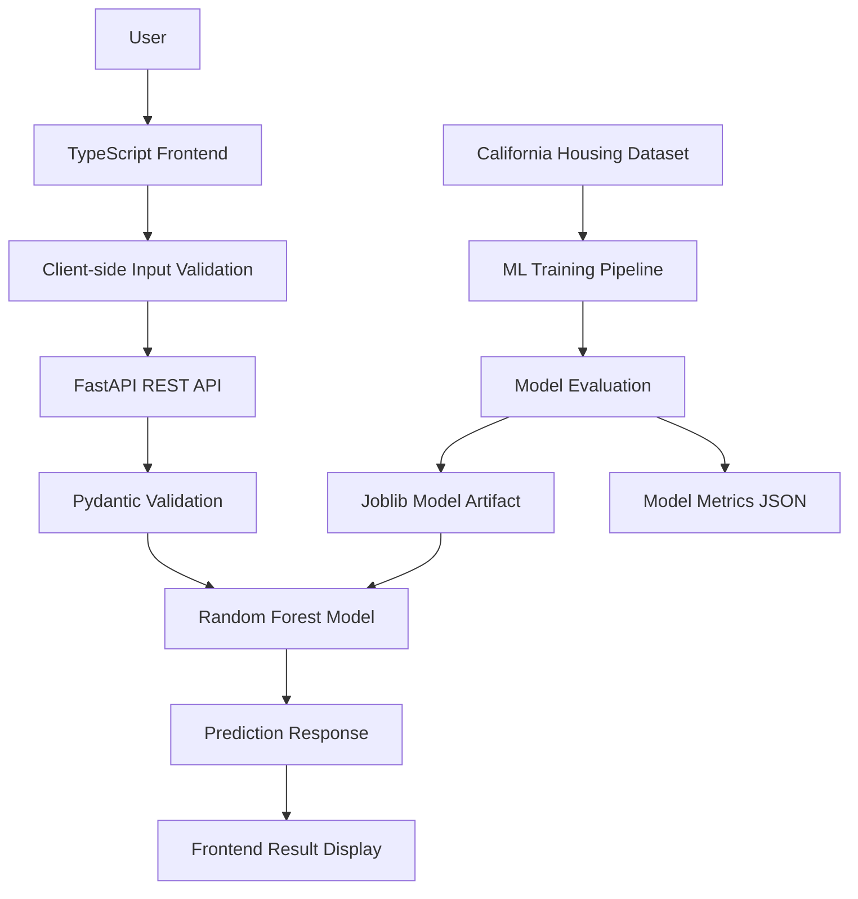
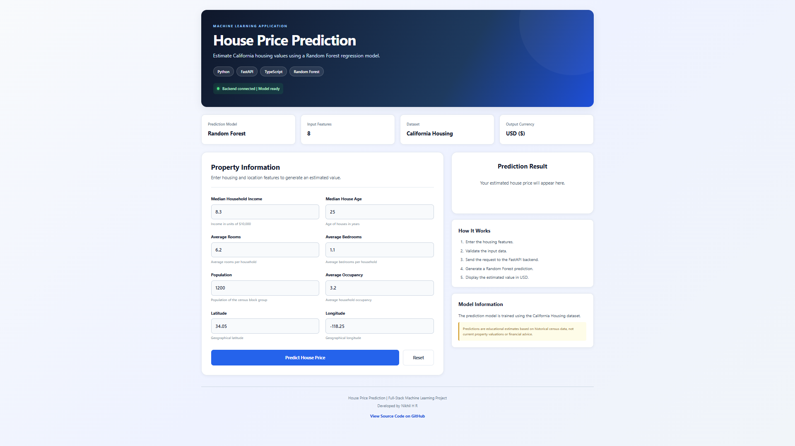
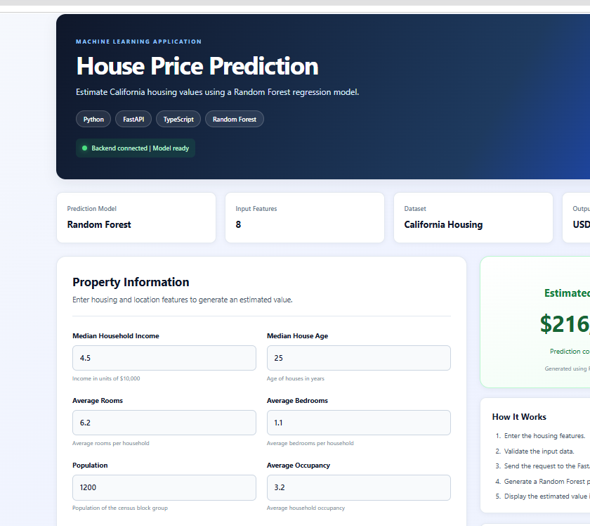
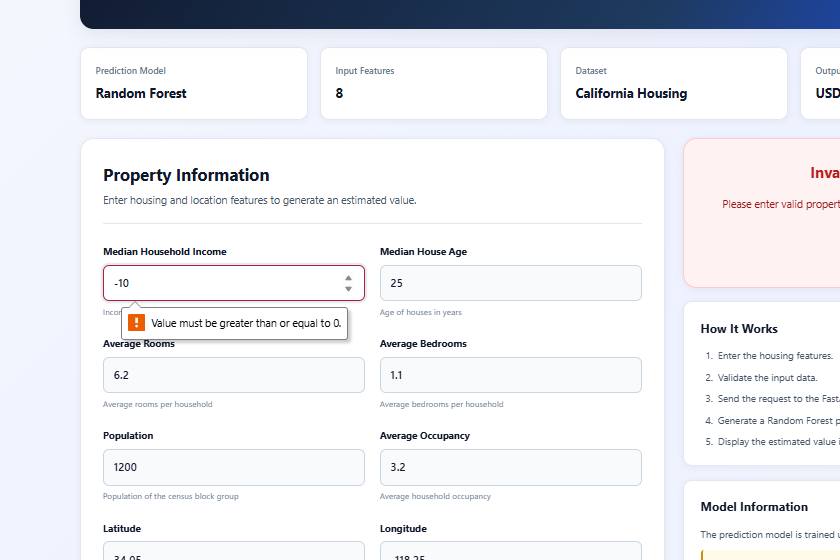
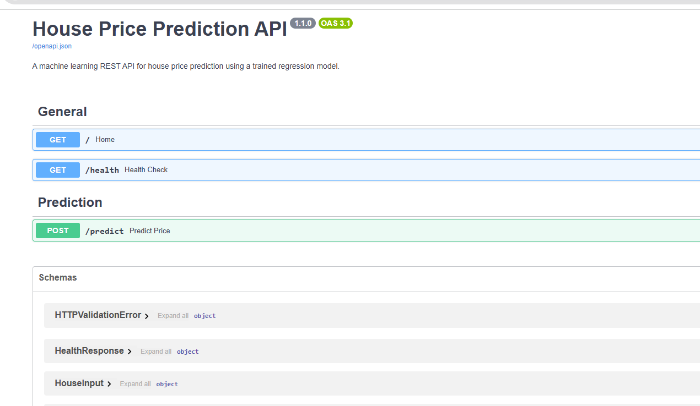
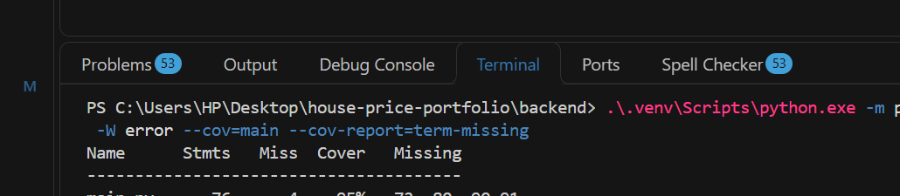

# House Price Prediction | Full-Stack Machine Learning Application


[](https://github.com/NikhilH-R/house-price-prediction-devops/actions/workflows/ci.yml)

---

## Project Overview

An end-to-end machine learning web application designed to estimate California housing values using a Random Forest regression model.

The application integrates a Python-based machine learning training pipeline, a FastAPI REST backend, and a responsive TypeScript frontend.

The project demonstrates practical skills in software engineering, machine learning, API development, automated testing, input validation, and full-stack application integration.

---

## Key Achievements

| Metric | Result |
|---|---:|
| Dataset size | 20,640 records |
| Training samples | 16,512 |
| Testing samples | 4,128 |
| Input features | 8 |
| Random Forest estimators | 100 |
| R² score | 0.803723 |
| Mean Absolute Error | $32,798.67 |
| Root Mean Squared Error | $50,715.16 |
| Cross-validation folds | 5 |
| Mean cross-validation MAE | $33,471.67 |
| Automated API tests | 38 passed |
| Backend statement coverage | 95% |
| Frontend production build | Successful |

Results are based on local training and testing conducted on 25 November 2026.

---

## Key Features

### Machine Learning

- Random Forest regression model.
- California Housing dataset integration.
- Dataset validation and preprocessing.
- Reproducible training and testing split.
- Five-fold cross-validation.
- MAE, MSE, RMSE and R² evaluation.
- Feature importance analysis.
- Model persistence using Joblib.
- Structured model performance reporting.

### Backend Engineering

- FastAPI REST API architecture.
- Pydantic request and response schemas.
- Server-side input validation.
- Structured application logging.
- Model loading and availability monitoring.
- Exception handling.
- Configurable CORS settings.
- Interactive Swagger API documentation.
- Automated API tests using Pytest.

### Frontend Engineering

- Responsive TypeScript and Vite interface.
- Eight housing and geographical input features.
- Real-time backend connectivity status.
- Dynamic prediction results.
- USD currency formatting.
- Client-side input validation.
- Loading-state management.
- Input locking during prediction requests.
- Stale prediction clearing.
- User-friendly error messages.
- Form reset functionality.
- Configurable backend API URL.

---

## System Architecture



---

## Technology Stack

| Category | Technologies |
|---|---|
| Programming | Python, TypeScript |
| Frontend | Vite, HTML5, CSS3 |
| Backend | FastAPI, Pydantic, Uvicorn |
| Machine Learning | Scikit-learn, Random Forest |
| Data Processing | Pandas, NumPy |
| Model Persistence | Joblib |
| Testing | Pytest, Pytest-cov, HTTPX |
| API Documentation | Swagger UI, OpenAPI |
| Version Control | Git, GitHub |

---

## Dataset Information

The model uses the California Housing dataset available through Scikit-learn.

The dataset contains 20,640 observations and eight predictive features.

| Feature | Description |
|---|---|
| MedInc | Median household income in units of $10,000 |
| HouseAge | Median house age in years |
| AveRooms | Average rooms per household |
| AveBedrms | Average bedrooms per household |
| Population | Census block group population |
| AveOccup | Average household occupancy |
| Latitude | Geographical latitude |
| Longitude | Geographical longitude |

The original target values are expressed in units of $100,000. They are converted into USD during model training.

---

## Machine Learning Pipeline

The training pipeline follows these stages:

1. Load the California Housing dataset.
2. Validate dataset features.
3. Convert target values into USD.
4. Split the dataset into training and testing subsets.
5. Perform five-fold cross-validation.
6. Train the Random Forest regression model.
7. Evaluate performance on the held-out test dataset.
8. Calculate feature importance.
9. Save the trained model using Joblib.
10. Export evaluation results to JSON.

### Model Configuration

| Parameter | Value |
|---|---|
| Algorithm | RandomForestRegressor |
| Number of estimators | 100 |
| Random state | 42 |
| Training split | 80% |
| Testing split | 20% |
| Parallel processing | n_jobs=-1 |
| Target currency | USD |

---

## Model Performance

### Held-out Test Results

| Evaluation Metric | Value |
|---|---:|
| Mean Absolute Error (MAE) | $32,798.67 |
| Mean Squared Error (MSE) | 2,572,027,919.70 USD² |
| Root Mean Squared Error (RMSE) | $50,715.16 |
| R² Score | 0.803723 |

The R² score indicates that the trained model explains approximately 80.37% of the variance in housing values within the held-out test dataset.

### Cross-Validation Results

| Fold | MAE (USD) |
|---|---:|
| Fold 1 | $34,436.22 |
| Fold 2 | $32,885.06 |
| Fold 3 | $33,118.66 |
| Fold 4 | $33,662.97 |
| Fold 5 | $33,255.42 |
| Mean MAE | $33,471.67 |
| Standard deviation | $544.51 |

### Feature Importance

| Feature | Importance |
|---|---:|
| Median Income | 52.4854% |
| Average Occupancy | 13.8365% |
| Latitude | 8.9019% |
| Longitude | 8.8561% |
| House Age | 5.4489% |
| Average Rooms | 4.4381% |
| Population | 3.0642% |
| Average Bedrooms | 2.9689% |

Median household income has the highest model-derived feature importance.

Feature importance represents the contribution of features within the trained model and does not establish causation.

---

## REST API Documentation

The backend exposes the following endpoints:

| Method | Endpoint | Description |
|---|---|---|
| GET | / | Application information |
| GET | /health | Backend and model availability |
| POST | /predict | Generate a housing value prediction |
| GET | /docs | Interactive Swagger documentation |
| GET | /openapi.json | OpenAPI specification |

### Health Check

```http
GET /health
```

Example response:

```json
{
  "status": "healthy",
  "model_loaded": true
}
```

### House Price Prediction

```http
POST /predict
```

Example request:

```json
{
  "MedInc": 8.3,
  "HouseAge": 25,
  "AveRooms": 6.2,
  "AveBedrms": 1.1,
  "Population": 1200,
  "AveOccup": 3.2,
  "Latitude": 34.05,
  "Longitude": -118.25
}
```

Example response:

```json
{
  "predicted_price_usd": 440549.47,
  "message": "Prediction completed successfully"
}
```

---

## Automated Testing

The backend includes an automated API test suite implemented using Pytest.

Testing covers API functionality, prediction requests, input validation, error handling, and HTTP endpoint behaviour.

### Verified Local Test Results

| Testing Metric | Result |
|---|---:|
| Tests passed | 38 |
| Tests failed | 0 |
| Backend statements | 76 |
| Uncovered statements | 4 |
| Backend statement coverage | 95% |
| Reported warnings | 0 |

The coverage percentage applies to the backend main.py module rather than the entire repository.

### Manual Integration Testing

| Test Scenario | Result |
|---|---|
| Backend connectivity | Passed |
| Model availability | Passed |
| Prediction with income 8.3 | $440,549.47 |
| Prediction with income 4.5 | $216,166.00 |
| Negative income validation | Passed |
| Stale result clearing on invalid input | Passed |
| Default input restoration | Passed |
| Frontend production build | Passed |

---

## Project Structure

```text
house-price-prediction-devops/
├── backend/
│   ├── main.py
│   ├── train_model.py
│   ├── test_api.py
│   ├── requirements.txt
│   ├── .gitignore
│   ├── house_price_model.pkl   # Generated locally
│   └── model_metrics.json      # Training metrics
│
├── frontend/
│   ├── public/
│   │   ├── favicon.svg
│   │   └── icons.svg
│   ├── src/
│   │   ├── assets/
│   │   ├── counter.ts
│   │   ├── main.ts
│   │   └── style.css
│   ├── index.html
│   ├── package.json
│   ├── package-lock.json
│   ├── tsconfig.json
│   └── .gitignore
│
├── .gitignore
└── README.md
```

---

## Installation and Local Setup

### Prerequisites

- Python
- Node.js and npm
- Git
- Internet access for dependency installation and initial dataset download

The project was locally tested using Python 3.14.5 and Node.js 24.16.0.

### Step 1: Clone the Repository

```bash
git clone https://github.com/NikhilH-R/house-price-prediction-devops.git
cd house-price-prediction-devops
```

### Step 2: Configure the Backend

Open a PowerShell terminal:

```powershell
cd backend
python -m venv .venv
```

Install the required dependencies:

```powershell
.\.venv\Scripts\python.exe -m pip install --upgrade pip
.\.venv\Scripts\python.exe -m pip install -r requirements.txt
```

Verify dependency compatibility:

```powershell
.\.venv\Scripts\python.exe -m pip check
```

### Step 3: Train the Machine Learning Model

```powershell
.\.venv\Scripts\python.exe train_model.py
```

The training pipeline generates:

- house_price_model.pkl
- model_metrics.json

The trained model must be generated before starting the prediction API.

### Step 4: Start the Backend

```powershell
.\.venv\Scripts\python.exe -m uvicorn main:app --host 127.0.0.1 --port 8000
```

Backend URL:

http://127.0.0.1:8000

API documentation:

http://127.0.0.1:8000/docs

Health check:

http://127.0.0.1:8000/health

### Step 5: Configure the Frontend

Open a separate terminal from the repository root:

```powershell
cd frontend
npm.cmd ci
```

Start the frontend development server:

```powershell
npm.cmd run dev
```

Frontend URL:

http://localhost:5173

Keep both the backend and frontend servers running.

---

## Running Automated Tests

From the backend directory:

```powershell
.\.venv\Scripts\python.exe -m pytest test_api.py -v --cov=main --cov-report=term-missing
```

---

## Frontend Production Build

From the frontend directory:

```powershell
npm.cmd run build
```

Preview the generated production build:

```powershell
npm.cmd run preview
```

The application build is generated in the frontend/dist directory.

---

## Application Demonstration

The user enters eight housing-related features into the dashboard.

The frontend validates the input and communicates with the FastAPI backend. The backend processes the request using the trained Random Forest model and returns an estimated housing value in USD.

The application also displays backend availability, prediction status, validation errors, and model information.

---

## Engineering Practices

- Separation of frontend and backend responsibilities.
- Typed API request and response contracts.
- Reproducible machine learning experiments.
- Automated backend testing.
- Dependency version management.
- Configurable application settings.
- Input validation and error handling.
- Application logging.
- Git-based version control.
- Exclusion of virtual environments and generated model artifacts from source control.

---

## Project Limitations

- The model is trained on historical California housing data.
- Predictions represent estimated median housing values for census block groups rather than individual property appraisals.
- The model does not incorporate current real estate market conditions.
- Random train-test splitting may not fully capture geographical generalisation performance.
- Predictions are intended for educational and technical demonstration purposes.
- The application is currently demonstrated through local execution.

---

## Future Improvements

- GitHub Actions continuous integration.
- Docker-based application deployment.
- Cloud-hosted application demonstration.
- Automated frontend and end-to-end browser testing.
- Hyperparameter optimisation.
- Geographical cross-validation.
- Model explainability visualisations.
- Additional application monitoring.

---

## Application Screenshots

### 1. Application Dashboard

Full-stack machine learning interface with eight housing input features and backend connectivity monitoring.



### 2. Successful House Price Prediction

Live property value estimation using the trained Random Forest Regression model and FastAPI backend.



### 3. Input Validation and Error Handling

Invalid inputs are detected and appropriate validation messages are displayed to the user.



### 4. Interactive API Documentation

Interactive Swagger UI documentation for testing and exploring REST API endpoints.



### 5. Automated Backend Testing

- 38 automated tests passed.
- Zero test failures.
- 95% statement coverage of backend main.py.
- Zero reported test warnings in the final local run.



---


## Developer

**Nikhil H R**

MSc Data Science and Artificial Intelligence

Newcastle University, United Kingdom

Interests: Software Engineering, Artificial Intelligence, Machine Learning and Full-Stack Development.

[](https://www.linkedin.com/in/nikhil-h-r-813582257/)

[](https://github.com/NikhilH-R)
